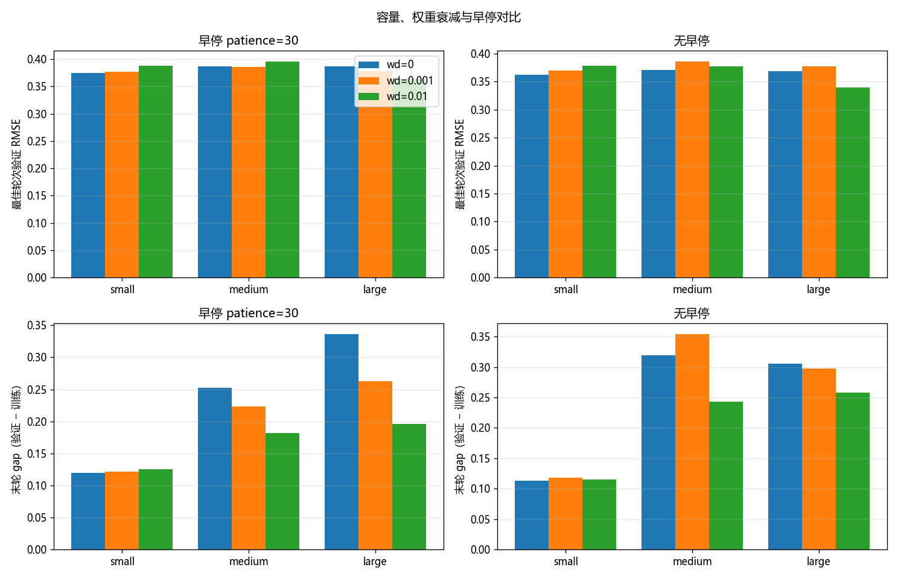
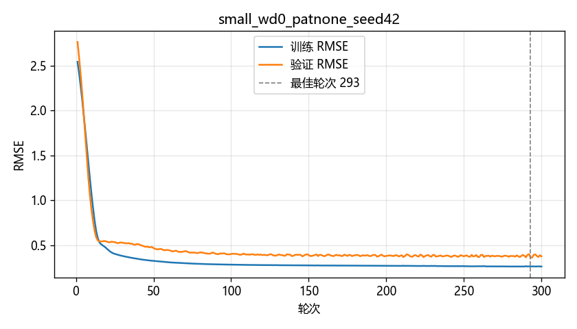
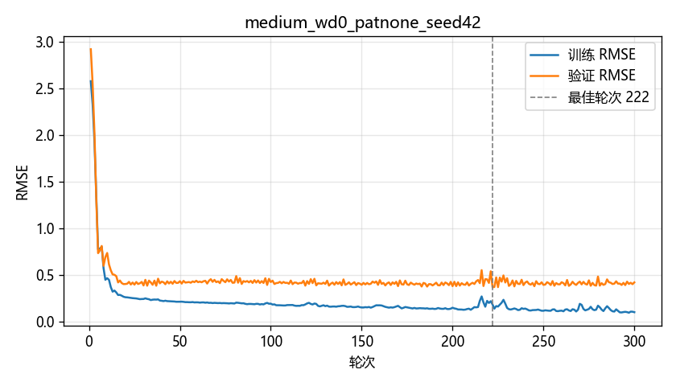
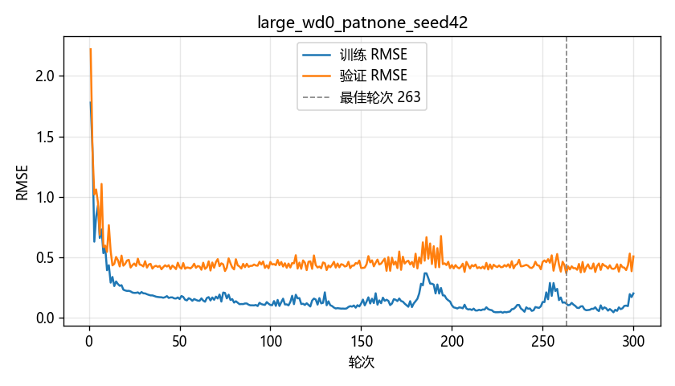
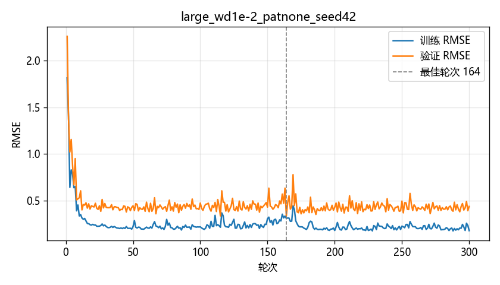

# 回归泛化：标准化、过拟合与早停

用一个可配置容量的多层感知机，在同一份小规模回归数据上比较**模型容量**、**权重衰减**和**早停**。预处理统计量只在训练子集上拟合；每次实验都保留验证 RMSE 最低的权重，最后只用这一份权重对测试集推理一次，生成 `submission.csv`。

## 任务目标

数据是平台生成的教学合成数据，用来练习流程，不代表真实公开基准。需要完成的事情是：

- 从 `train.csv` 中划出验证子集，自己调参，不靠公开榜反复猜测隐藏标签。
- 缺失值填补和标准化只使用训练子集；验证集和测试集复用同一组参数。
- 比较不同容量、权重衰减和早停设置。
- 保存验证集上最好的模型，并用它做一次测试集推理。
- 报告训练误差和验证误差的差距，用来观察过拟合。

评价指标是 RMSE，即预测与目标之差的均方根，越小越好。公开榜只用一部分隐藏测试数据；题目关闭后，最终提交按剩余测试数据排名。

## 数据

| 文件 | 行数 | 列 |
| --- | --- | --- |
| `data/train.csv` | 156 | `id`, `f1`, `f2`, `f3`, `f4`, `target` |
| `data/test.csv` | 84 | `id`, `f1`, `f2`, `f3`, `f4` |
| `sample_submission.csv` | 84 | `id`, `prediction`，常数预测，对应页面上的参考分 |

四个特征都是连续值。当前这两份文件里没有缺失值，预处理仍然按“用训练子集均值填补”实现，避免以后出现空值时把验证集或测试集算进统计量。

按种子 42 做 80/20 划分后，训练子集 125 行，验证子集 31 行。用训练子集的目标均值去预测验证子集，RMSE 为 **3.3122**。后面的神经网络都远低于这个参照。

## 项目结构

```
Task2/
  data/
    train.csv
    test.csv
  src/
    data.py          # 读表、划分、只在训练子集上拟合的预处理
    model.py         # 可配置宽度和深度的 MLP
    train.py         # 单次训练、权重衰减、早停、保存最佳权重
    experiment.py    # 容量 × 权重衰减 × 早停
    predict.py       # 读取最佳检查点，生成 submission.csv
    utils.py         # 损失曲线和汇总图
  configs.py         # 路径、种子和实验网格
  baseline.py        # 标准库 kNN 起点，读写 data/ 下的 CSV
  requirements.txt
  sample_submission.csv
  submission.csv     # predict.py 的输出
  output/
    summary.csv
    checkpoints/<实验名>/best_model.pt
    figures/<实验名>_loss_curve.png
    figures/summary_compare.png
```

## 方法

### 划分和预处理

`Preprocessor.fit` 只接收训练子集。填补值、均值和标准差都在这 125 行上计算；验证集和测试集只调用 `transform`。检查点里同时保存了这组参数，推理时直接复用，不会在全部训练数据或测试数据上重新估计。

`python src/data.py` 会检查两件事：标准化后的训练子集均值接近 0，以及这组均值不等于“训练子集 + 验证子集”合在一起的均值。

### 模型

三档容量，激活函数是 ReLU，输出一个标量。dropout 固定为 0，避免和容量混在一起。

| 名称 | 隐藏层 | 参数量 |
| --- | --- | --- |
| small | 8 | 49 |
| medium | 32, 16 | 705 |
| large | 128, 64, 32 | 11009 |

优化器是 Adam，学习率 `1e-2`，批大小 32。训练损失是 MSE，记录和早停使用的都是 RMSE。权重衰减通过 Adam 的 `weight_decay` 加入，比较 `0`、`1e-3`、`1e-2`。最多训练 300 轮。随机种子是 42。

### 早停和最佳权重

早停看验证 RMSE。验证误差连续 30 轮没有下降就停止；另一组设置不早停，训满 300 轮。两种设置都只把验证 RMSE 最低的那一轮权重写进检查点。

因此报告里有两套误差：

- **最佳轮**：真正被保存、用来推理的模型。`gap = 验证 RMSE − 训练 RMSE`。
- **末轮**：训练结束时的模型。如果末轮训练误差继续下降、验证误差上升，说明继续训练已经过拟合；提交时不能用这组权重。

## 运行

在项目根目录执行：

```bash
pip install -r requirements.txt
python src/data.py
python src/experiment.py
python src/predict.py
```

`experiment.py` 写出 `output/summary.csv` 和 `output/figures/`。`predict.py` 按验证 RMSE 最低（相同则取更小的 gap）选择检查点，生成根目录的 `submission.csv`。

`python baseline.py` 会用 5 近邻重写 `submission.csv`。需要 kNN 对照文件时再运行；之后要恢复神经网络提交，再执行一次 `python src/predict.py`。

## 实验设计

网格是 3 种容量 × 3 个权重衰减 × 2 种早停，共 18 组，种子都是 42，划分也相同。验证集只有 31 行，名次对划分比较敏感；这里固定种子，是为了让容量、正则和早停的对比不被另一套随机划分干扰。没有根据公开榜改这些设置。

## 实验结果

下表保留四位小数，完整数值在 `output/summary.csv`。

| 容量 | 权重衰减 | 早停 | 实际轮数 | 最佳轮 | 训练 RMSE | 验证 RMSE | gap | 末轮训练 | 末轮验证 | 末轮 gap |
| --- | ---: | --- | ---: | ---: | ---: | ---: | ---: | ---: | ---: | ---: |
| small | 0 | 30 | 176 | 146 | 0.2748 | 0.3753 | 0.1005 | 0.2724 | 0.3920 | 0.1195 |
| small | 0 | 无 | 300 | 293 | 0.2633 | 0.3619 | 0.0986 | 0.2614 | 0.3749 | 0.1135 |
| small | 0.001 | 30 | 176 | 146 | 0.2750 | 0.3774 | 0.1024 | 0.2728 | 0.3939 | 0.1211 |
| small | 0.001 | 无 | 300 | 294 | 0.2644 | 0.3699 | 0.1055 | 0.2635 | 0.3812 | 0.1177 |
| small | 0.01 | 30 | 190 | 160 | 0.2762 | 0.3886 | 0.1124 | 0.2698 | 0.3956 | 0.1258 |
| small | 0.01 | 无 | 300 | 293 | 0.2646 | 0.3784 | 0.1139 | 0.2639 | 0.3789 | 0.1150 |
| medium | 0 | 30 | 67 | 37 | 0.2387 | 0.3872 | 0.1485 | 0.2050 | 0.4577 | 0.2527 |
| medium | 0 | 无 | 300 | 222 | 0.1864 | 0.3713 | 0.1848 | 0.1042 | 0.4234 | 0.3192 |
| medium | 0.001 | 30 | 67 | 37 | 0.2426 | 0.3860 | 0.1434 | 0.2190 | 0.4418 | 0.2227 |
| medium | 0.001 | 无 | 300 | 164 | 0.1776 | 0.3857 | 0.2081 | 0.1244 | 0.4791 | 0.3547 |
| medium | 0.01 | 30 | 126 | 96 | 0.2294 | 0.3955 | 0.1661 | 0.2175 | 0.3995 | 0.1820 |
| medium | 0.01 | 无 | 300 | 293 | 0.1982 | 0.3770 | 0.1788 | 0.1984 | 0.4415 | 0.2431 |
| large | 0 | 30 | 105 | 75 | 0.2062 | 0.3869 | 0.1808 | 0.0984 | 0.4350 | 0.3366 |
| large | 0 | 无 | 300 | 263 | 0.1185 | 0.3692 | 0.2506 | 0.2024 | 0.5081 | 0.3057 |
| large | 0.001 | 30 | 97 | 67 | 0.1575 | 0.3779 | 0.2204 | 0.1635 | 0.4263 | 0.2629 |
| large | 0.001 | 无 | 300 | 67 | 0.1575 | 0.3779 | 0.2204 | 0.1408 | 0.4385 | 0.2977 |
| large | 0.01 | 30 | 97 | 67 | 0.2335 | 0.3635 | 0.1300 | 0.2206 | 0.4165 | 0.1959 |
| large | 0.01 | 无 | 300 | 164 | 0.3139 | **0.3399** | **0.0260** | 0.1836 | 0.4419 | 0.2584 |



小模型的训练和验证曲线靠得比较近，一直到第 300 轮仍在缓慢下降：



中等模型在无正则时，最佳轮之后训练误差继续下降，验证误差转差。这是更典型的过拟合：



无正则的大模型把训练 RMSE 压到 0.1185，验证 RMSE 仍有 0.3692，曲线也更抖：



最终选用的大模型加 `weight_decay=0.01`。最佳轮在第 164 轮，之后训练误差还在降，验证误差已经变差，所以必须恢复第 164 轮的权重：



每组实验的曲线都在 `output/figures/`。

## 实验分析

**容量。** 小模型只有 49 个参数，最佳轮 gap 稳定在 0.10 左右，末轮 gap 也只有约 0.11。中等模型末轮训练 RMSE 可以降到 0.1042，验证 RMSE 升到 0.4234，gap 达到 0.3192。大模型在无权重衰减时，最佳轮训练 RMSE 为 0.1185，gap 为 0.2506。容量增大以后，网络更能记住 125 行训练子集，训练误差和验证误差被拉开。

只看最佳轮的验证 RMSE，盲目加大容量并没有好处。无权重衰减、不早停时，small / medium / large 分别是 0.3619、0.3713、0.3692。大网络在没有约束时，并没有比小网络更接近验证集。

**权重衰减。** 小模型上，把衰减从 0 加到 0.01，验证 RMSE 从 0.3619 变到 0.3784，略差。小网络本身记不住太多训练噪声，再加强 L2 会损失拟合。大模型上情况反过来：`weight_decay=0.01` 的最佳验证 RMSE 是全表最低的 0.3399，最佳轮 gap 只有 0.0260；同一结构不加衰减时，gap 是 0.2506。权重衰减要加在容量已经过大的模型上才有帮助。它也没有取消末轮过拟合：这组配置训到第 300 轮时，训练 RMSE 降到 0.1836，验证 RMSE 升到 0.4419，gap 为 0.2584。

**早停。** `patience=30` 对这条噪声比较大的验证曲线偏短，经常停在一次暂时的平台上，错过后面更好的轮次。最终配置如果用 30 轮耐心，会在第 97 轮停止，最佳验证 RMSE 是 0.3635（第 67 轮）；继续训练后，第 164 轮可以到 0.3399。

也有早停刚好够用的情况。`large`、`weight_decay=0.001` 的两组实验，最佳轮都是第 67 轮，验证 RMSE 都是 0.3779。继续训到 300 轮不会改掉已保存的模型，只会让末轮 gap 从 0.2629 增加到 0.2977。这时早停省下的是无效训练，提交质量不变。

所以早停的作用是少跑没有改进的轮次，不能代替“保存最佳验证权重”。在这组网格里，验证集太小、曲线来回跳动，较短的耐心会提前停掉，因此提交模型选择的是训满 300 轮、再恢复第 164 轮的那一次。若误用末轮权重，验证 RMSE 会从 0.3399 变差到 0.4419。

最佳轮验证 RMSE 在 18 组里只分布在大约 0.34 到 0.40 之间，差别小于过拟合差距的差别。容量和正则首先改变的是训练误差会不会脱离验证误差，其次才是验证误差本身。

## 最终提交

选用 `large_wd1e-2_patnone_seed42`：

- 隐藏层 128、64、32，参数量 11009
- 权重衰减 0.01，不使用早停
- 恢复第 164 轮权重
- 该轮训练 RMSE 0.3139，验证 RMSE 0.3399，gap 0.0260
- 预处理参数来自同一次划分的 125 行训练子集

`python src/predict.py` 已用这份检查点对 84 条测试样本推理一次，结果写在 `submission.csv`。
